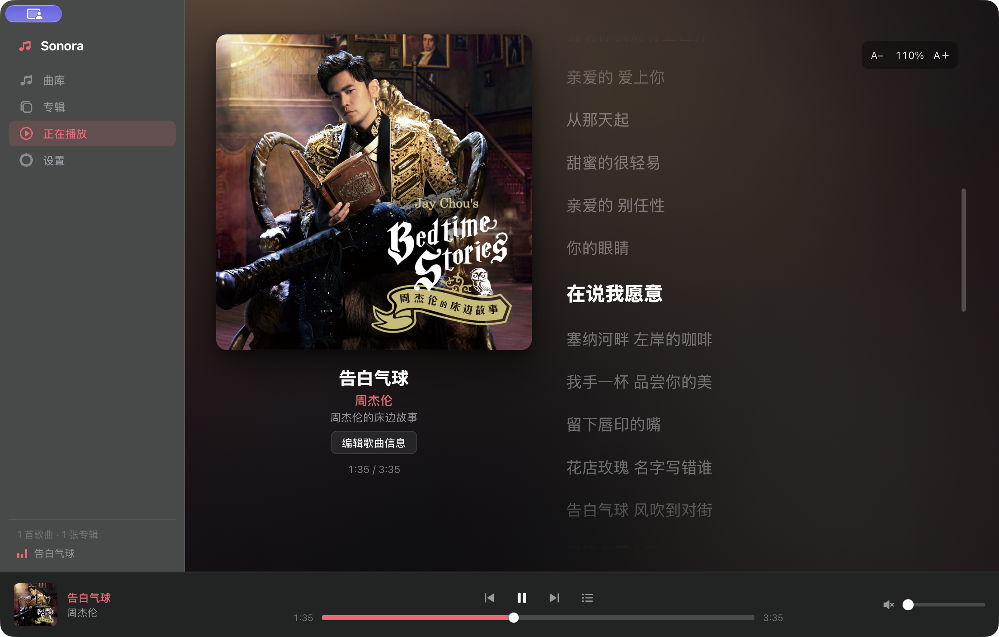
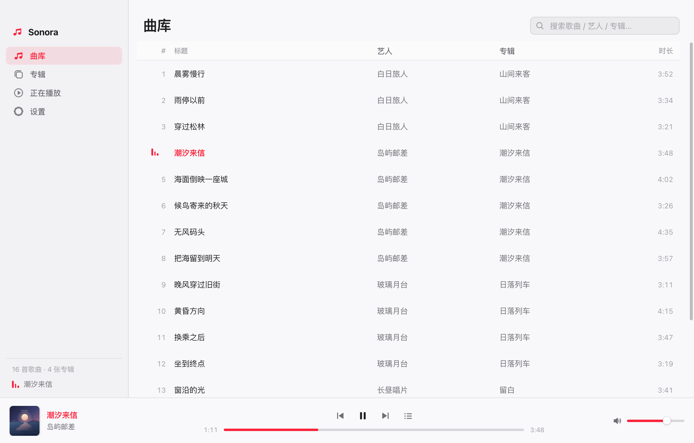

# Sonora

[简体中文](README.zh-CN.md)

**A lightweight, responsive local music player for macOS with a clean interface and live lyrics in the menu bar.**

Sonora organizes your music files into a searchable library. Follow lyrics in the macOS menu bar while you work, or click the menu bar icon to open the mini player. Sonora automatically matches missing lyrics and album art through NetEase Cloud Music and QQ Music. You can also edit a track’s details, retry the match, and fetch different artwork for that song.

Sonora uses the system WebView and a Rust audio engine. Incremental scans, a SQLite index, a virtualized track list, and precomputed cover images reduce memory and rendering overhead as you browse and play music.

[Download](https://github.com/wengjincheng/Sonora/releases/latest) · [Quick start](#quick-start) · [Supported features](#supported-features) · [Contributing](#contributing)

## Screenshots


[View the menu bar at full size](docs/screenshots/menu-bar-lyrics.png?raw=true)





The menu bar and Now Playing screenshots show the same track playing in Sonora on macOS. The library screenshot uses demo data. The app interface is currently in Simplified Chinese.

## Install

1. Download `Sonora_0.1.0_aarch64.dmg` from [GitHub Releases](https://github.com/wengjincheng/Sonora/releases/latest). The first installer is for Apple Silicon Macs.
2. Open the disk image, drag Sonora to **Applications**, then launch it from there.
3. The installer contains an ad hoc-signed app. If macOS blocks the first launch, verify that you downloaded the DMG from this repository and select **Open Anyway** in **System Settings → Privacy & Security**. [Apple’s instructions](https://support.apple.com/en-us/102445)

## Quick start

1. **Import your music.** Drop a music folder into Sonora or go to **Settings → Music Folders → Add Folder**. Sonora scans subfolders. Use **Rescan** after adding or moving files.
2. **Play and browse.** Double-click a track in **Library** to start playing the current list from that track. Search by title, artist, or album, or open a record in **Albums** and click **Play**. Use the bottom playback bar to seek, change volume, or switch playback modes.
3. **Follow the lyrics.** Open **Now Playing** or press `⌘L`. Click a lyric line to seek to it, and use `A−` and `A＋` to adjust the text size. To supply your own synchronized lyrics, put a UTF-8 LRC file next to the audio with the same base name, such as `Night Tide.flac` and `Night Tide.lrc`.
4. **Fix a lyric or artwork match.** Online matching is enabled by default under **Settings → Lyrics & Artwork**. Right-click a track to open the track editor, update the title, artist, or album, and choose **Save and Fetch Again**. To fetch artwork for just that song, enable the track-specific artwork option in the editor. You can also switch it back to the album artwork there.
5. **Listen from the menu bar.** Under **Settings → Menu Bar**, enable lyrics and adjust their display width. Click the menu bar icon for the mini player or right-click it for playback and window controls. Closing the window keeps playback running. Press `⌘Q` to quit.

## Supported features

| Area | Features |
| --- | --- |
| Local audio | MP3, FLAC, WAV, M4A / MP4 (AAC and ALAC), OGG / OGA (Vorbis), and AIFF / AIF. Audio is decoded on-device and plays offline. |
| Library | Recursive folder import, incremental rescans, tag reading, album browsing, and search by title, artist, or album. |
| Playback | Sequential play, shuffle, repeat all, and repeat one. Sonora restores the last track, queue, playback mode, and volume. |
| Synchronized lyrics | Same-name LRC files take priority, followed by cached lyrics. Online lookups can use AMLL word-synced TTML, NetEase Cloud Music, QQ Music, and LRCLIB. Now Playing lyrics scale from 80% to 300%. |
| Artwork and editing | Reads embedded art and fills in missing album artwork via QQ Music, NetEase Cloud Music, or KuGou. Edit track details, retry lyric and artwork matches, or fetch independent artwork for a single track. |
| macOS integration | Scrolling menu bar lyrics, mini player, media keys, Control Center, menu bar-only mode, and launch at login. |
| Appearance | Light, dark, and system themes. |

Your music files, library index, edits, and cache are stored locally. Online matching queries third-party services using track details such as the title and artist. [AMLL TTML database](https://github.com/amll-dev/amll-ttml-db) · [LRCLIB](https://lrclib.net/)

### Keyboard shortcuts

| Shortcut | Action |
| --- | --- |
| `Space` | Play or pause |
| `←` / `→` | Seek backward or forward by 5 seconds |
| `⌘←` / `⌘→` | Previous or next track |
| `↑` / `↓` | Raise or lower volume |
| `⌘L` | Open Now Playing |
| `⌘F` | Search the library |

## Build from source

You’ll need macOS, Xcode Command Line Tools, Node.js 22, pnpm, and Rust 1.90 or later. [Tauri prerequisites](https://v2.tauri.app/start/prerequisites/)

```bash
git clone https://github.com/wengjincheng/Sonora.git
cd Sonora
pnpm install --frozen-lockfile
pnpm tauri dev
```

The React frontend lives in `src/`. The Rust backend and macOS integration live in `src-tauri/`. Run `pnpm tauri build` to build the `.app` and `.dmg` under `src-tauri/target/release/bundle/`. Sonora stores its library database and cover cache in `~/Library/Application Support/com.wengjincheng.own-music-player/`.

```bash
pnpm build
node --experimental-vm-modules --test tests/lyrics-ui-state.test.mjs
cargo test --locked --manifest-path src-tauri/Cargo.toml
```

## Contributing

Bug reports, feature ideas, documentation improvements, and pull requests are welcome.

- **Report a bug.** Check for an existing issue, then include your Sonora and macOS versions, Mac architecture, steps to reproduce, and expected and actual behavior. For playback or lyrics issues, add the file format or lyrics source when relevant. [GitHub Issues](https://github.com/wengjincheng/Sonora/issues)
- **Suggest a feature.** Open an issue describing your use case and the behavior you would like. Discuss larger changes before starting work.
- **Submit a pull request.** Fork the repository, branch from `main`, run the relevant checks, and open a PR against `main`. Describe the change, link the related issue, and include screenshots for UI changes. [GitHub Pull Requests](https://github.com/wengjincheng/Sonora/pulls)

## License

Sonora’s source code is available under the [MIT License](LICENSE). See the [third-party notices](THIRD-PARTY-NOTICES.txt) for licenses and source links for bundled components.
