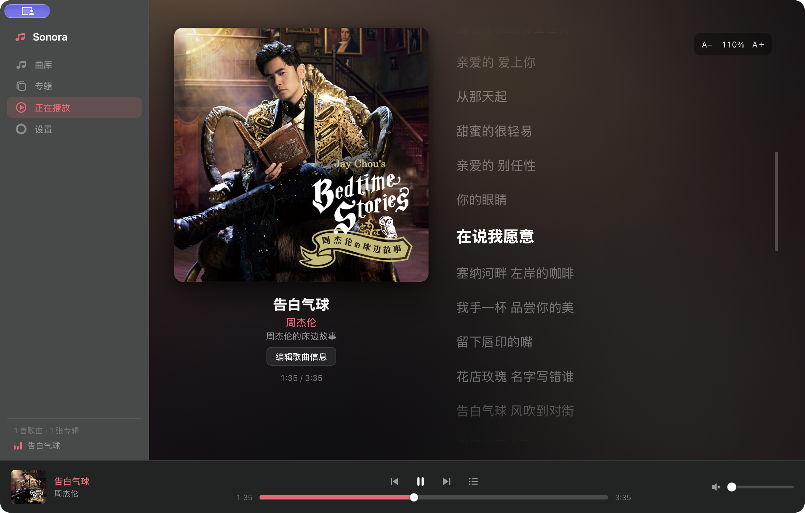
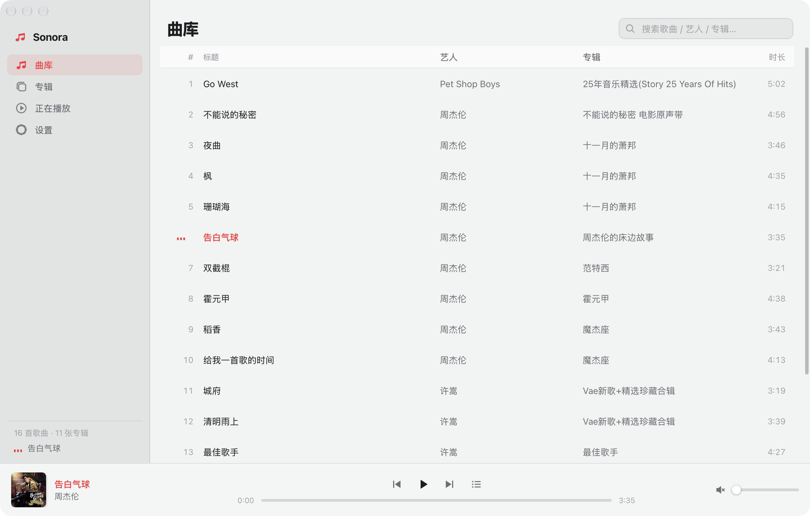

# Sonora

[English](README.md)

**轻量、响应快、界面简洁的 macOS 本地音乐播放器。**

Sonora 把本地音乐整理成可搜索的曲库和专辑。切到其他应用时，仍能在 macOS 状态栏看着歌词跟唱，点一下状态栏图标即可打开迷你播放器。网易云音乐和 QQ 音乐可自动为曲库补全歌词和专辑封面。匹配偏差时，可以编辑歌曲信息后重新获取，或给这一首歌单独匹配封面。

Sonora 使用 macOS 自带的 WebView 和 Rust 音频引擎。曲库以 SQLite 索引和增量扫描更新，列表按需渲染，封面缩略图和模糊背景提前生成。这些设计减少了常驻内存和界面渲染开销，让浏览、搜索和切歌保持轻快。

[下载最新版](https://github.com/wengjincheng/Sonora/releases/latest) · [快速上手](#快速上手) · [当前支持](#当前支持) · [参与贡献](#参与贡献)

## 界面截图


[查看原尺寸菜单栏](docs/screenshots/menu-bar-lyrics.png?raw=true)





截图采自 macOS 上的原生 Sonora。状态栏和正在播放窗口均展示周杰伦的《告白气球》，曲库窗口展示实际导入的本地音乐。

## 安装

1. 从 [GitHub Releases](https://github.com/wengjincheng/Sonora/releases/latest) 下载 `Sonora_0.1.0_aarch64.dmg`。首发安装包适用于 Apple Silicon（M 系列）Mac。
2. 打开 DMG，将 Sonora 拖到「应用程序」，再从那里启动。
3. 安装包使用临时签名（ad hoc）。如果首次打开时 macOS 拦截了应用，确认安装包来自本仓库后，前往「系统设置 → 隐私与安全性」选择「仍要打开」。[Apple 安装说明](https://support.apple.com/zh-cn/102445)

## 快速上手

1. **导入音乐。** 将音乐文件夹拖进 Sonora，或打开「设置 → 音乐文件夹 → 添加文件夹…」。Sonora 会扫描子目录。新增或移动歌曲后，可以在同一处点击「重新扫描」。
2. **播放与查找。** 在「曲库」双击一首歌，从该曲目开始播放当前列表。可按歌曲、艺人或专辑搜索，也可在「专辑」中打开唱片后点击「播放」。底部控制栏可调整音量、进度和播放模式。
3. **查看歌词。** 打开「正在播放」或按 `⌘L`。点击歌词行可以跳到对应时间，`A−` / `A＋` 可以调整字号。已有本地歌词时，将 UTF-8 编码的同名 LRC 放在音频旁，例如 `潮汐来信.flac` 和 `潮汐来信.lrc`。
4. **补全或纠正歌词和封面。** 「设置 → 歌词与封面 → 在线获取歌词和封面」默认开启。匹配不准时，右键歌曲打开「编辑歌曲信息」，修正标题、艺人或专辑，然后点击「保存并重新获取」。想给这一首歌换封面时，勾选「为这首歌单独匹配封面」。也可以在同一对话框恢复使用专辑封面。
5. **用状态栏控制播放。** 在「设置 → 菜单栏」开启歌词并调整显示宽度。左键状态栏图标打开迷你播放器，右键访问播放控制和主窗口。关窗后可以继续播放，按 `⌘Q` 退出应用。

## 当前支持

| 支持项 | 能力 |
| --- | --- |
| 本地音频 | MP3、FLAC、WAV、M4A / MP4（AAC、ALAC）、OGG / OGA（Vorbis）、AIFF / AIF。音频在本机解码，断网时也能播放。 |
| 曲库 | 扫描文件夹、读取文件标签和内嵌封面、按专辑浏览、按曲名 / 艺人 / 专辑搜索。 |
| 播放 | 顺序、随机、列表循环、单曲循环。保存上次的曲目、队列、播放模式和音量。 |
| 同步歌词 | 优先同名 LRC，其次本地缓存。在线匹配支持 [AMLL TTML 逐字歌词](https://github.com/amll-dev/amll-ttml-db)、网易云音乐、QQ 音乐和 [LRCLIB](https://lrclib.net/)。主窗口歌词字号可调至 80%–300%。 |
| 封面与编辑 | 读取内嵌封面，缺失时通过 QQ 音乐、网易云音乐或酷狗音乐补全。支持手动重新匹配歌词和封面，以及为指定歌曲保存单独封面。 |
| macOS 集成 | 状态栏滚动歌词、迷你播放器、系统媒体键和控制中心、仅菜单栏模式、登录自启。 |
| 外观 | 跟随系统或固定为浅色、深色。 |

曲库索引、编辑记录、缓存和音频文件保存在本机。在线匹配会向第三方服务查询曲名和艺人等元数据。

### 主窗口快捷键

| 快捷键 | 操作 |
| --- | --- |
| `空格` | 播放 / 暂停 |
| `←` / `→` | 后退 / 前进 5 秒 |
| `⌘←` / `⌘→` | 上一首 / 下一首 |
| `↑` / `↓` | 调高 / 降低音量 |
| `⌘L` | 打开正在播放 |
| `⌘F` | 搜索曲库 |

## 本地开发

需要 macOS、Xcode 命令行工具、Node.js 22、pnpm 和 Rust 1.90 或更新版本。[Tauri 开发环境说明](https://v2.tauri.app/start/prerequisites/)

```bash
git clone https://github.com/wengjincheng/Sonora.git
cd Sonora
pnpm install --frozen-lockfile
pnpm tauri dev
```

前端源码在 `src/`，Rust 后端和 macOS 集成在 `src-tauri/`。运行 `pnpm tauri build` 会生成 `.app` 和 `.dmg`，默认输出到 `src-tauri/target/release/bundle/`。曲库数据库和封面缓存位于 `~/Library/Application Support/com.wengjincheng.own-music-player/`。

```bash
pnpm build
node --experimental-vm-modules --test tests/lyrics-ui-state.test.mjs
cargo test --locked --manifest-path src-tauri/Cargo.toml
```

## 参与贡献

欢迎报告问题、提出功能建议、改进文档和提交代码。

- **报告问题。** 先查找已有记录。创建 Issue 时，请附上 Sonora 版本、macOS 版本与芯片架构、复现步骤、预期和实际表现。歌词或播放问题也请注明音频格式及歌词来源。[GitHub Issues](https://github.com/wengjincheng/Sonora/issues)
- **讨论功能。** 在 Issue 中描述使用场景和希望实现的行为。涉及较大改动时，先在 Issue 中讨论方案。
- **提交 Pull Request。** Fork 仓库，从 `main` 创建分支，完成相关验证后向 `main` 提交 PR。说明改动、验证步骤，并关联对应 Issue。界面改动请附截图。[GitHub Pull Requests](https://github.com/wengjincheng/Sonora/pulls)

## 许可证

Sonora 源码采用 [MIT License](LICENSE)。随 macOS 应用分发的第三方组件及其许可见 [第三方授权声明](THIRD-PARTY-NOTICES.txt)。
